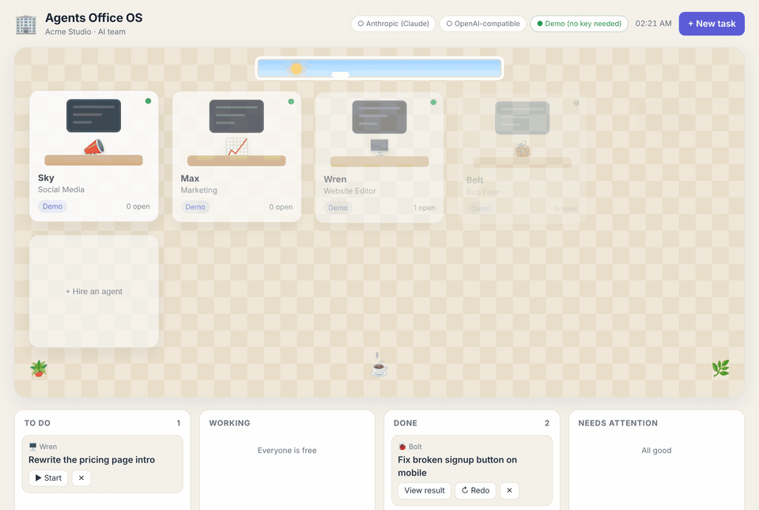
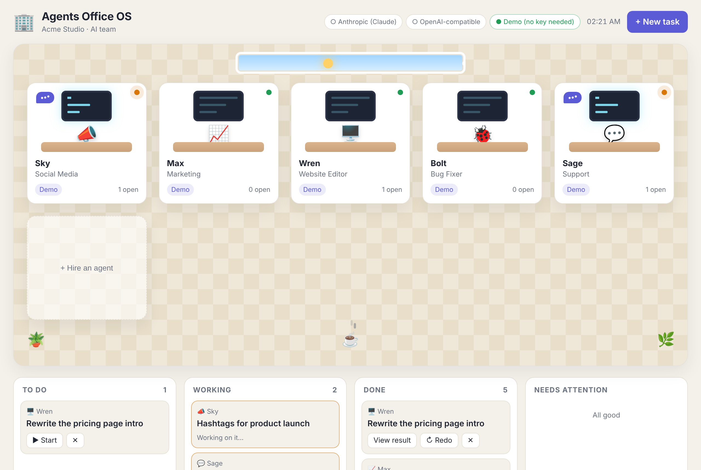
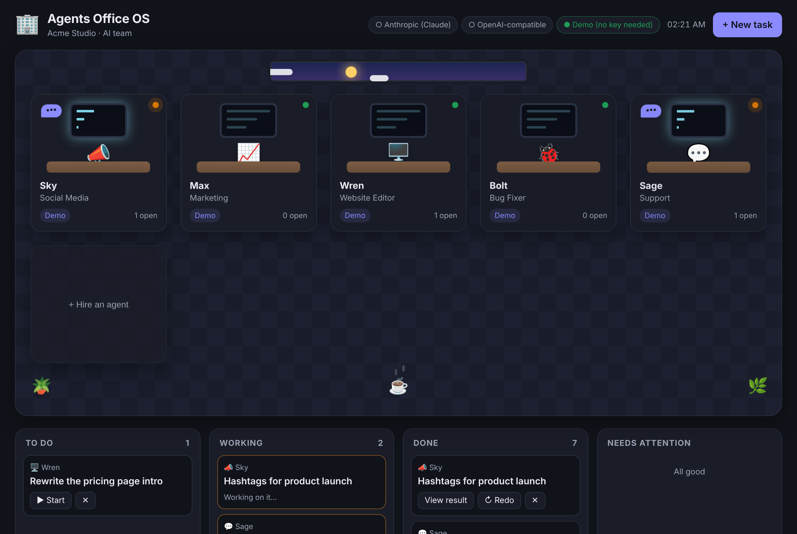

# Agents Office OS

**An office for your AI team.** Each agent has a desk and a job: social media,
marketing, website editing, bug fixes or customer support. Give them tasks, watch
them work, and read what they hand back.



- **Five agents ready to go**, each with its own instructions, and you can hire more
- **Bring any AI**: Anthropic (Claude), any OpenAI-compatible API (OpenAI, OpenRouter, Groq, Together, a local Ollama), or the built-in demo
- **One model per agent**: put your support agent on a fast, cheap model and your bug fixer on a strong one
- **Task board**: to do, working, done and needs attention, updated live
- **Your keys stay yours**: keys are read from your local `.env` file only, never saved in the office data or sent to the browser
- Light and dark mode, no build step, runs on Node 22+

| Light | Dark |
|---|---|
|  |  |

## Quick start

```sh
git clone https://github.com/wesomitsu/Agents-Office-OS.git
cd Agents-Office-OS
npm install
npm start
```

Open http://localhost:3000. Every agent starts on the **Demo** provider, so you
can try the office before adding any keys.

## Add your AI providers

```sh
cp .env.example .env
```

Fill in the providers you use, restart `npm start`, then click an agent's desk to
switch its provider and model.

| Provider | In `.env` | Default model |
|---|---|---|
| Anthropic (Claude) | `ANTHROPIC_API_KEY` | `claude-opus-5-5` |
| OpenAI | `OPENAI_API_KEY` | `gpt-5` |
| OpenRouter, Groq, Together... | `OPENAI_API_KEY` + `OPENAI_BASE_URL` | set the model on the agent |
| Ollama (local) | `OPENAI_BASE_URL=http://localhost:11434/v1` | set the model on the agent, e.g. `llama3.1` |

The header shows which providers are ready (●) and which still need a key (○).

## The team

| Agent | Responsible for |
|---|---|
| 📣 Sky | Social media posts, hooks and hashtags |
| 📈 Max | Marketing: campaigns, emails, landing page copy |
| 🖥️ Wren | Website editing: copy, structure, HTML/CSS changes |
| 🐞 Bolt | Bug fixes: likely cause first, then a minimal diff |
| 💬 Sage | Customer support replies |

Click a desk to rename an agent, change its emoji, job, provider, model or
instructions. Click **+ Hire an agent** to add someone new (SEO, sales, HR...).

Set `COMPANY_NAME` and `COMPANY_ABOUT` in `.env` and every agent knows who they
work for.

## How it works

- `src/server.js`: a small HTTP server for the page and a JSON API
- `src/store.js`: agents and tasks, saved to `data/office.json` (git-ignored)
- `src/providers.js`: calls Anthropic through the official SDK, or any OpenAI-compatible `/chat/completions` endpoint
- `src/runner.js`: builds each agent's prompt and records the result on the task
- `public/`: the office page, plain HTML, CSS and JavaScript

### API

| Method | Path | What it does |
|---|---|---|
| `GET` | `/api/office` | Agents, tasks and provider status |
| `POST` | `/api/tasks` | Create a task `{ title, details, agentId }` |
| `POST` | `/api/tasks/:id/run` | Start (or redo) a task |
| `PATCH`/`DELETE` | `/api/tasks/:id` | Edit or delete a task |
| `POST` | `/api/agents` | Hire an agent |
| `PATCH`/`DELETE` | `/api/agents/:id` | Edit or remove an agent |

## Safety notes

- The server listens on `localhost` only by default. Anyone who can open the
  office can spend your API credit, so put real authentication in front of it
  before setting `HOST=0.0.0.0` or deploying it.
- Agents write drafts. They don't post, send emails or change your website by
  themselves; you review the result and use it.

## Development

```sh
npm test
```

## License

MIT
