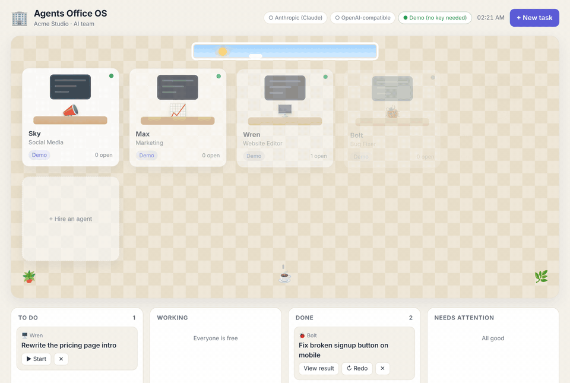
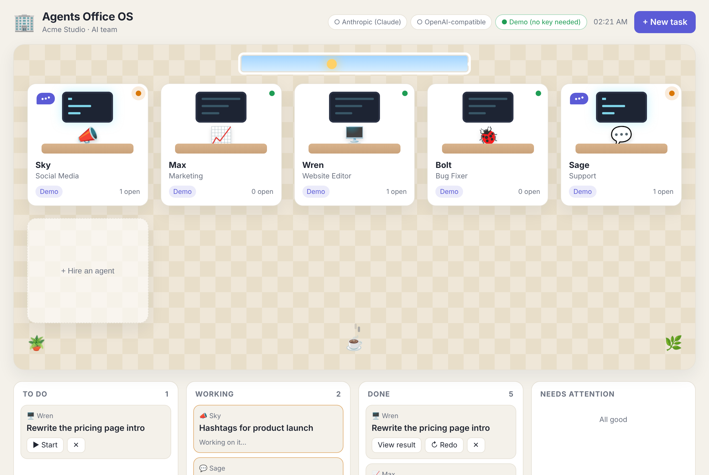
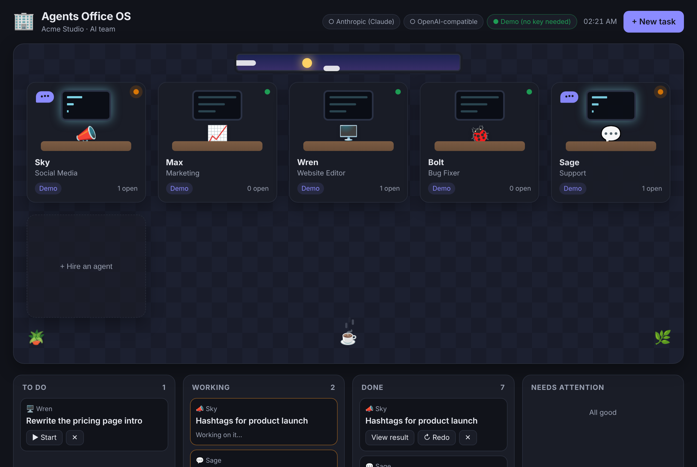

# Agents Office OS

**An office for your AI team.** Each agent has a desk and a job: social media,
marketing, website editing, bug fixes or customer support. Give them tasks, watch
them work, and read what they hand back.



- **Five agents ready to go**, each with its own instructions, and you can hire more
- **Bring any AI**: Anthropic (Claude), any OpenAI-compatible API (OpenAI, OpenRouter, Groq, Together, a local Ollama), or the built-in demo
- **One model per agent**: put your support agent on a fast, cheap model and your bug fixer on a strong one
- **Task board**: to do, working, done and needs attention, updated live, with high-priority tasks on top and overdue tasks flagged
- **Readable results**: formatted output you can copy or download as Markdown, or export every task as CSV
- **Duplicate**: copy any task into the new-task form to tweak and reuse it
- **Repeating tasks**: set a task to repeat daily or weekly and the next one is queued when it's done
- **Follow-ups**: reply to a finished task ("make it shorter") and the agent revises it, keeping the conversation
- **Hand-offs**: pass a result to another agent, e.g. Marketing's campaign to Social Media for posts
- **Your keys stay yours**: keys are read from your local `.env` file only, never saved in the office data or sent to the browser
- Light and dark mode, works on phones, no build step, runs on Node 22+

| Light | Dark |
|---|---|
|  |  |

## Quick start

```sh
git clone https://github.com/wesomitsu/Agents-Office-OS.git
cd Agents-Office-OS
npm install
npm start
```

Open http://localhost:3000. Every agent starts on the **Demo** provider, so you
can try the office before adding any keys.

### With Docker

```sh
docker build -t agents-office .
docker run -p 3000:3000 --env-file .env -e OFFICE_PASSWORD=change-me -v office-data:/data agents-office
```

Your agents and tasks are kept in the `office-data` volume. Keys come from your
`.env` file at run time and are never baked into the image.

## Add your AI providers

```sh
cp .env.example .env
```

Fill in the providers you use, restart `npm start`, then click an agent's desk to
switch its provider and model.

| Provider | In `.env` | Default model |
|---|---|---|
| Anthropic (Claude) | `ANTHROPIC_API_KEY` | `claude-opus-5-5` |
| OpenAI | `OPENAI_API_KEY` | `gpt-5` |
| OpenRouter, Groq, Together... | `OPENAI_API_KEY` + `OPENAI_BASE_URL` | set the model on the agent |
| Ollama (local) | `OPENAI_BASE_URL=http://localhost:11434/v1` | set the model on the agent, e.g. `llama3.1` |

At most 3 tasks call a model at the same time (`MAX_CONCURRENT_TASKS`, `0` for
no limit); the rest show "Waiting for a free slot" and start as soon as one
finishes.

If an OpenAI-compatible API is busy (429) or briefly down (5xx), the request is
retried up to 3 times. The Anthropic SDK has its own retries.

The header shows which providers are ready (●) and which still need a key (○).

## The team

| Agent | Responsible for |
|---|---|
| 📣 Sky | Social media posts, hooks and hashtags |
| 📈 Max | Marketing: campaigns, emails, landing page copy |
| 🖥️ Wren | Website editing: copy, structure, HTML/CSS changes |
| 🐞 Bolt | Bug fixes: likely cause first, then a minimal diff |
| 💬 Sage | Customer support replies |

Click a desk to rename an agent, change its emoji, job, provider, model or
instructions. Add the model's input and output prices ($ per 1M tokens, from your
provider's pricing page) and the desk shows an estimate of what that agent has
spent, based on the tokens its tasks used. Tick **Off duty** on a desk to stop an agent taking new tasks (they can't be
started until you turn it off again).

Click **+ Hire an agent** to add someone new, blank or from a template: SEO,
Sales, Content Writer, Data Analyst or HR & Hiring.

Use **Export team** to save your agents (names, jobs, providers, models and
instructions; never keys) to a file, and **Import team** to load them on another
machine or share a setup.

Set `NOTIFY_WEBHOOK_URL` to a Slack or Discord incoming-webhook URL and the
office posts a message (with a preview of the result) whenever a task finishes
or fails.

Set `COMPANY_NAME` and `COMPANY_ABOUT` in `.env` and every agent knows who they
work for.

## Keyboard shortcuts

| Key | Does |
|---|---|
| `n` | New task |
| `h` | Hire an agent |
| `f` | Jump to the board filter |
| `/` | Search tasks (title, details and results) |
| `1`–`9` | Show one agent's tasks (`0` for everyone) |
| `?` | Show the shortcuts |

## How it works

- `src/server.js`: a small HTTP server for the page and a JSON API
- `src/store.js`: agents and tasks, saved to `data/office.json` (git-ignored)
- `src/providers.js`: calls Anthropic through the official SDK, or any OpenAI-compatible `/chat/completions` endpoint
- `src/runner.js`: builds each agent's prompt and records the result on the task
- `public/`: the office page, plain HTML, CSS and JavaScript

### API

| Method | Path | What it does |
|---|---|---|
| `GET` | `/api/health` | `{ ok: true }` for Docker and uptime monitors (no login needed) |
| `GET` | `/api/office` | Agents, tasks and provider status |
| `POST` | `/api/tasks` | Create a task `{ title, details, agentId, priority, due, repeat }` (`high`/`normal`/`low`, due as `YYYY-MM-DD`, repeat `daily`/`weekly`) |
| `POST` | `/api/tasks/:id/run` | Start (or redo) a task |
| `POST` | `/api/tasks/:id/handoff` | Pass a finished result to another agent `{ agentId, note, run }` |
| `POST` | `/api/tasks/:id/reply` | Send a follow-up `{ message }` on a finished task |
| `PATCH`/`DELETE` | `/api/tasks/:id` | Edit or delete a task |
| `POST` | `/api/tasks/start-all` | Start every waiting task `{ agentId? }` (off-duty agents are skipped) |
| `POST` | `/api/tasks/clear-done` | Delete finished tasks `{ agentId? }` |
| `GET` | `/api/tasks.csv` | Download every task as a spreadsheet |
| `GET`/`POST` | `/api/export`, `/api/import` | Save or load the team `{ agents }` |
| `POST` | `/api/agents` | Hire an agent |
| `PATCH`/`DELETE` | `/api/agents/:id` | Edit or remove an agent |

## Safety notes

- The server listens on `localhost` only by default. Anyone who can open the
  office can spend your API credit, so set `OFFICE_PASSWORD` (the browser asks
  for it, any username works) before setting `HOST=0.0.0.0` or deploying, and
  serve it over HTTPS.
- Agents write drafts. They don't post, send emails or change your website by
  themselves; you review the result and use it.

## Development

```sh
npm test
```

## License

MIT
